## Overview

**GWizard Citation Fix** provides review steps for cleaning citation-related data in the active Family Tree. You can inspect suggested changes for sources, repositories, citations, citation attributes, citation media, and notes before applying them. The tool can also create a citation analysis report or run all cleanup steps without reviewing each set of hints.

## Usage

1. In Gramps, open **Tools > Family Tree Processing > GWizard Citation Fix**. **[VERIFY MENU PATH]**
2. In the **GWizard Citation Fix** window, choose a button below to open its report or cleanup step.
3. Review the suggestions in a cleanup dialog and use **Apply** to apply its changes. To run steps without reviewing them individually, use **Accept all hints**.
4. Close the open window or dialog when you are finished.

Main-window buttons, in screen order:

- **Generate report** — choose a file for the citation analysis report; the saved report then opens in a report window.
- **Unpack Conflated Source** — review suggestions to unpack mixed source text and prepare source fields.
- **Repository Consolidate** — review suggestions for consolidating repositories.
- **Fix Repositories** — review suggestions to create missing repositories and link sources to repositories.
- **Fix Sources** — review suggestions to merge near-duplicate sources and quarantine non-sources.
- **Unpack Conflated Citation** — review suggestions to extract dates and URLs from citation fields or notes.
- **Fix Citations** — review suggested citation page, date, and confidence cleanup.
- **Citation Attributes** — review suggested GPS quality attributes and confidence ratings.
- **Link Citation Media** — review suggestions for linking media to citations.
- **Fix Notes** — review suggested cleanup of citation notes.
- **Accept all hints** — confirm and run the cleanup steps without reviewing each step's hints.

### Generate report

1. Click **Generate report**. The **Save Citation Fix Report** file chooser opens.
   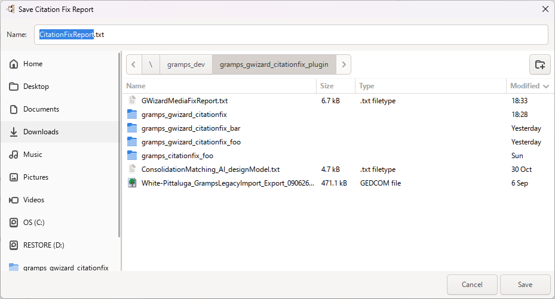
2. Choose a location and file name. The default name is `CitationFixReport.txt`. Click **Save**.
3. When the report has been written, the **GWizard Citation Fix report** window opens with its contents.
   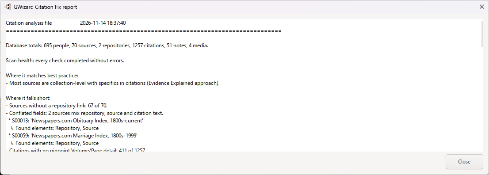
4. Click **Close** to return to the main window.

### Unpack Conflated Source

1. Click **Unpack Conflated Source**. The **Unpack Conflated Source** dialog opens.
   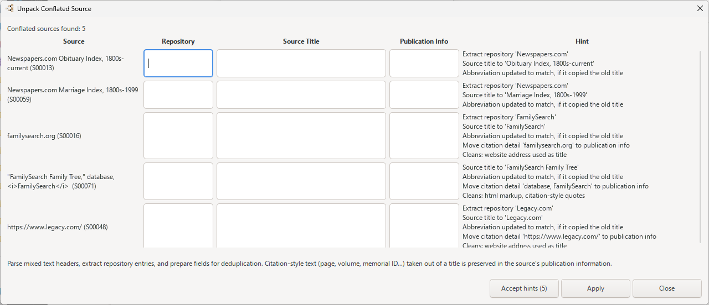
2. Review the suggested changes for mixed source text, repository entries, and publication information.
3. Click **Apply** to apply the selected changes, or **Close** to leave the dialog.

### Repository Consolidate

1. Click **Repository Consolidate**. The **Repository Consolidate** dialog opens.
   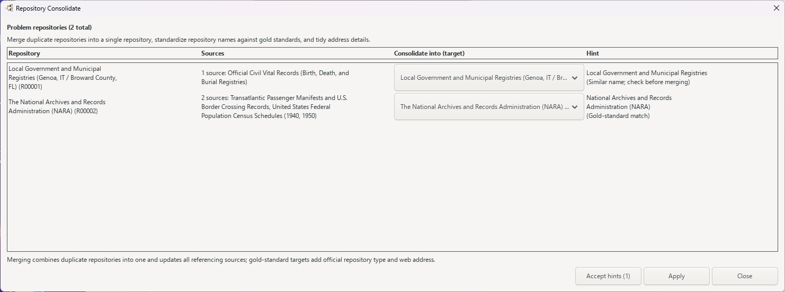
2. Review the repository suggestions and select the intended target where needed.
3. Click **Apply** to apply the changes, or **Close** to leave the dialog.

### Fix Repositories

1. Click **Fix Repositories**. The **Fix Repositories** dialog opens.
   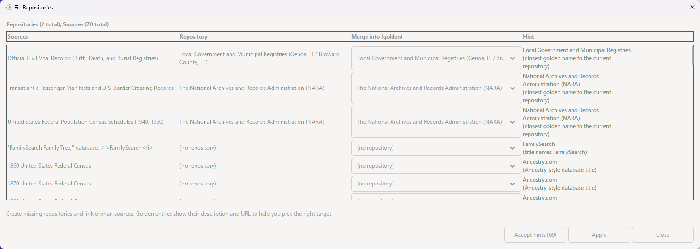
2. Review the suggested repository links and any missing repository entries.
3. Click **Apply** to apply the changes, or **Close** to leave the dialog.

### Fix Sources

1. Click **Fix Sources**. The **Fix Sources** dialog opens.
   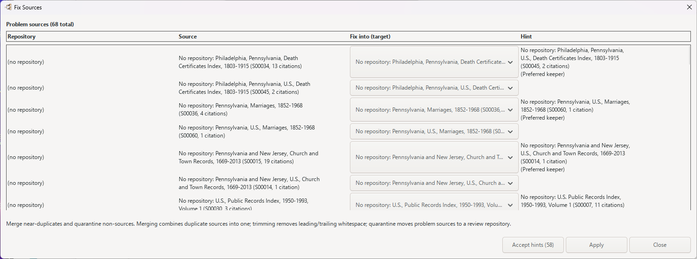
2. Review the suggested source merges and any entries identified as non-sources.
3. Click **Apply** to apply the changes, or **Close** to leave the dialog.

### Unpack Conflated Citation

1. Click **Unpack Conflated Citation**. The **Unpack Conflated Citation** dialog opens.
   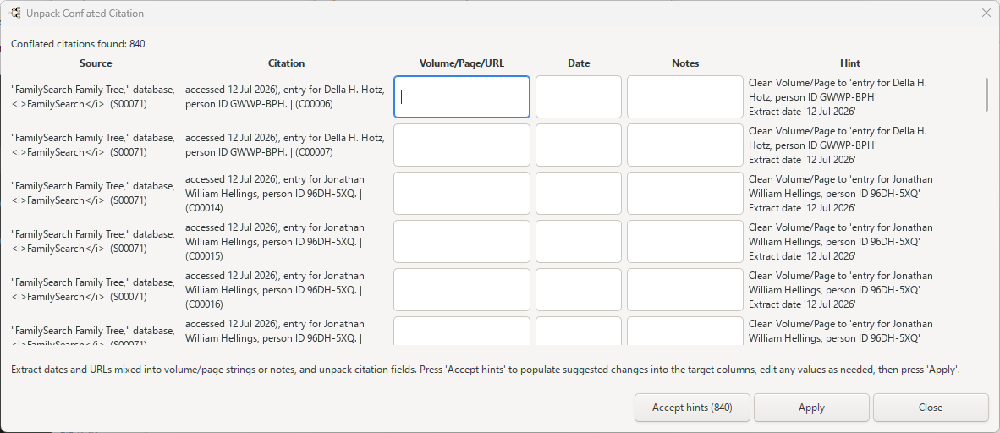
2. Review the suggestions for extracting dates and URLs from volume/page fields or notes.
3. Click **Apply** to apply the changes, or **Close** to leave the dialog.

### Fix Citations

1. Click **Fix Citations**. The **Fix Citations** dialog opens.
   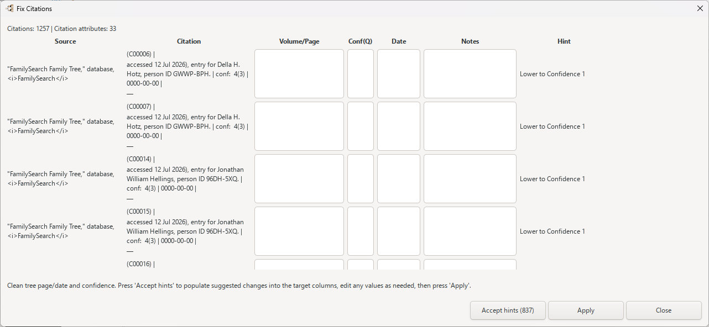
2. Review the suggested cleanup for citation page, date, and confidence values.
3. Click **Apply** to apply the changes, or **Close** to leave the dialog.

### Citation Attributes

1. Click **Citation Attributes**. The **Citation Attributes** dialog opens.
   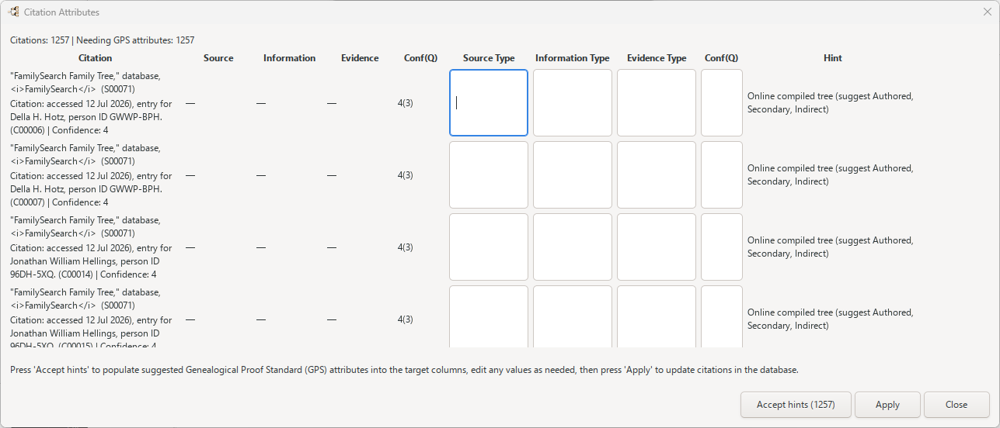
2. Review the suggested Genealogical Proof Standard (GPS) attributes—Source Type, Information Type, and Evidence Type—and confidence ratings.
3. Click **Apply** to apply the changes, or **Close** to leave the dialog.

### Link Citation Media

1. Click **Link Citation Media**. The **Link Citation Media** dialog opens.
   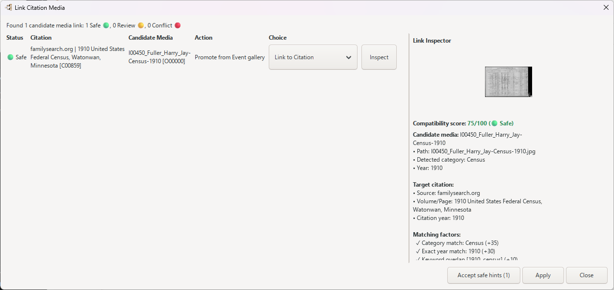
2. Review the proposed media links. Select a row and click **Inspect** to examine that link in the inspector.
3. Click **Apply** to apply the selected links, or **Close** to leave the dialog.

### Fix Notes

1. Click **Fix Notes**. The **Fix Notes** dialog opens.
   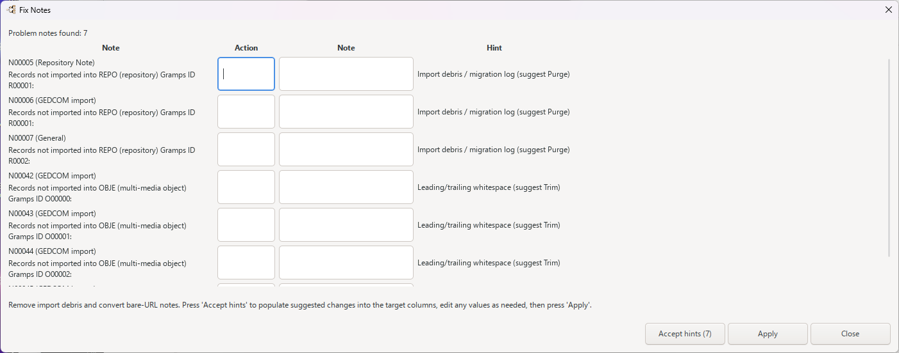
2. Review the notes suggested for cleanup.
3. Click **Apply** to apply the changes, or **Close** to leave the dialog.

### Accept all hints

1. Click **Accept all hints**. The **Accept all hints** confirmation dialog explains that the steps will run without individual review.
   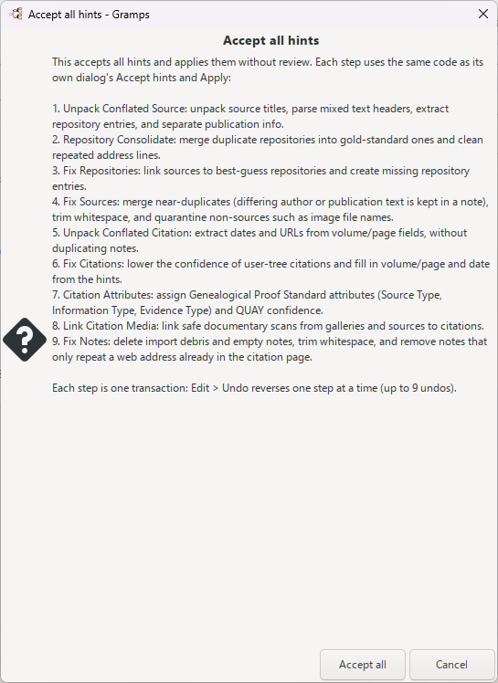
2. Click **Accept all** to proceed, or **Cancel** to return to the main window.
3. After the run, the **Accept All Hints Complete** window shows the results and any changes requiring human intervention.
   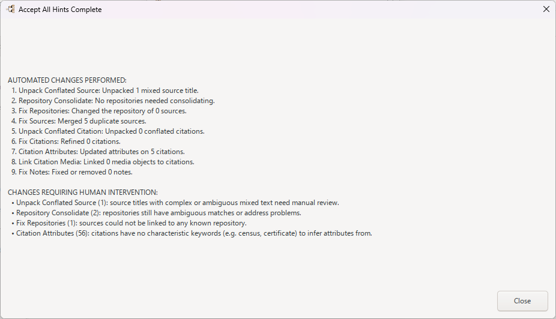
4. Click **Close** to return to the main window.

## Configure Options

- The main window has no configurable options such as checkboxes, fields, or preferences.

## Features

- Reviews cleanup suggestions for source titles and fields, repositories, sources, citation fields, citation attributes, citation media, and notes.
- Provides an individual review dialog for each cleanup step, with **Apply** and **Close** controls.
- Generates a citation analysis report at a location and file name you choose, then displays the saved report.
- **Accept all hints** runs the cleanup steps without individual review and displays a results window, including items that need human intervention.
