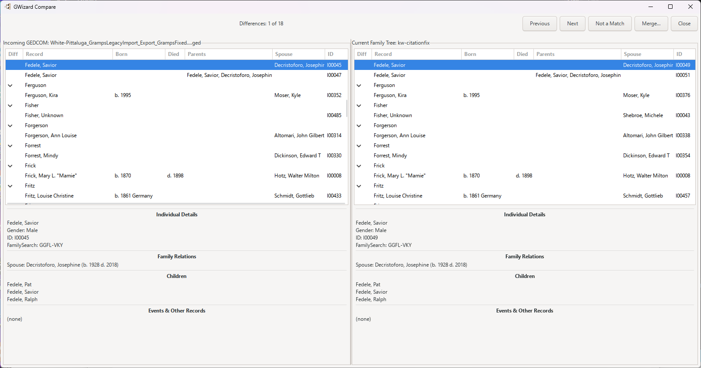
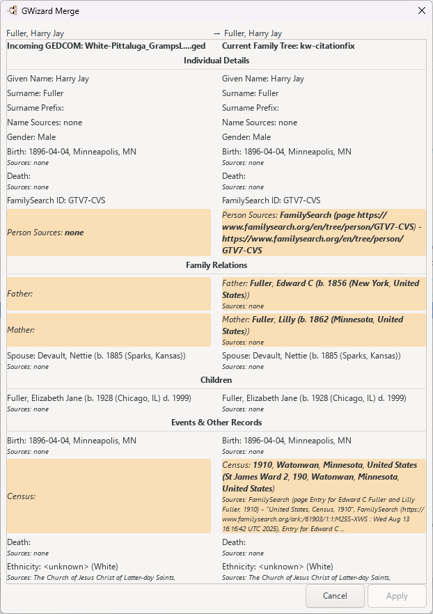

## Overview

Describe what **gwizard_filemerge** does and what genealogical workflow it improves.

## Usage

1. Open Gramps and navigate to **[VERIFY MENU PATH]**.
2. Configure your desired options and click **OK**.

## Configure Options

* **Option 1**: Description of option 1.

## Features

* Key feature 1.
