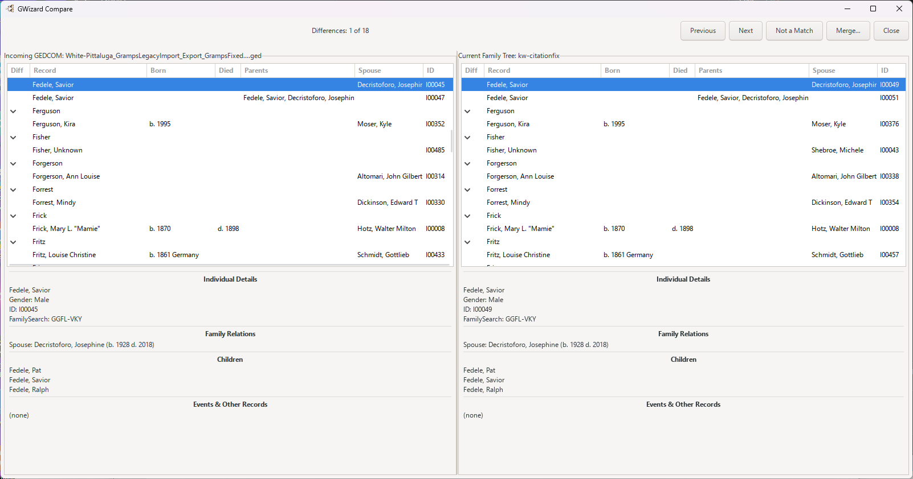
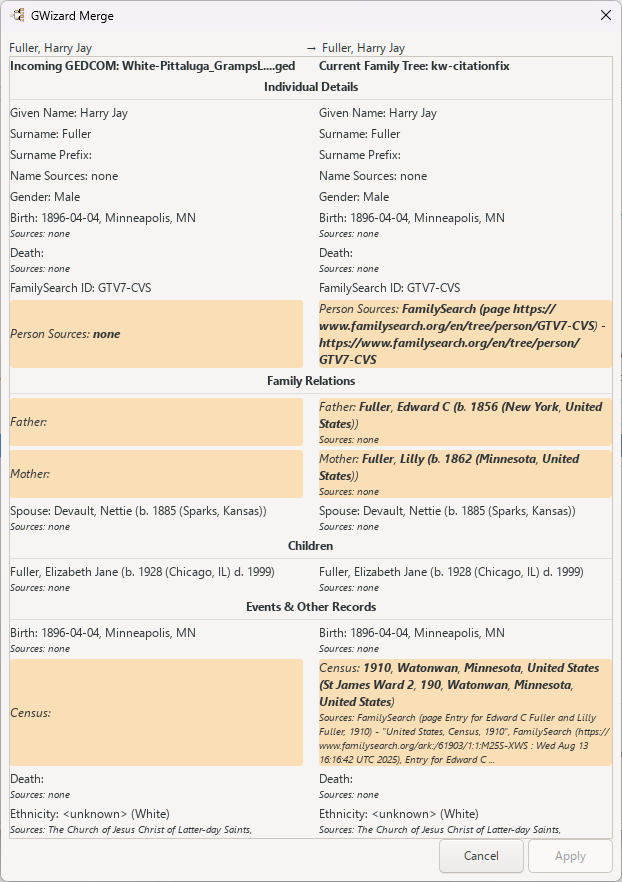

## Overview

GWizard File Merge is a Family Tree Processing tool for Gramps. It loads an external genealogy file — GEDCOM, Gramps XML, or any other supported import format — into a temporary source database and shows it side by side with the open Family Tree in the GWizard Compare window. You can then review each incoming person against a matched person in your tree and merge selected differences person by person, or add an incoming person as a brand-new record. Matches are suggested automatically, differing fields are offered one by one, and references that would otherwise become broken links (notes, media, citations, sources, repositories) are detected and offered for import before anything is written.

## Usage

1. With your Family Tree open, choose **Tools → Family Tree Processing → GWizard File Merge** from the menu.
2. In the **Select File to Compare** file chooser, browse to the external genealogy file and click **OK**. The chooser offers **All supported files** and **All files** filters.
3. While the file is read, a **Loading Data Merge** progress meter appears ("Reading the selected file...", then "Building the comparison window..."). If the file cannot be read, a **Load Failed** error is shown and nothing changes.
4. The **GWizard Compare** window opens, showing incoming people on the left and your Family Tree on the right. Difference status is shown per row; use the category sections to show **Individual Details**, **Family Relations**, **Children**, or **Events & Other Records**.

   

5. Step through the people that have differences using the **Previous** and **Next** buttons.
6. For each person, choose one of:
   - **Merge...** — open the field-by-field merge dialog for a matched person.
   - **Add as New...** — copy an unmatched incoming person into your Family Tree as a new person.

The main window toolbar buttons (left to right, excluding **Close**) are:

- **Previous** — Move to the previous person that has differences (wraps to the last).
- **Next** — Move to the next person that has differences (wraps to the first).
- **Add as New...** — Add the selected incoming person as a new person in your Family Tree.
- **Merge...** — Open the field-by-field merge dialog for the currently selected matched person pair.

### Previous

1. Make sure a person pair is shown in the compare window.
2. Click **Previous**.
3. The compare window re-highlights the previous person pair with differences and scrolls both panels to it. No new window opens.

### Next

1. Make sure a person pair is shown in the compare window.
2. Click **Next**.
3. The compare window re-highlights the next person pair with differences and scrolls both panels to it. No new window opens.

### Add as New...

1. In the left panel, select an incoming person that has no match in your Family Tree.
2. Click **Add as New...**.
3. The **Add as New Person** dialog opens, showing the incoming person's name and a preview of relatives already in your tree.

   

4. The **Link family relationships** checkbox is checked by default. Leave it checked to link the new person's relatives (father, mother, spouse, children) to matching people already in your tree; relatives with no match are linked when they are added.
5. Click **Add**. The incoming person, with their birth and death events and places, is copied into your Family Tree and the compare window refreshes.
6. If some relationships could not be linked, a **Some relationships were not linked** warning lists them after the add completes.

### Merge...

1. In the compare window, select a matched person pair (a person found in both the incoming file and your Family Tree). **Merge...** does nothing for an unmatched person.
2. Click **Merge...**.
3. The **GWizard Merge** dialog opens, showing each field of the incoming person on the left against the same field of your tree person on the right.

   

4. Fields are grouped under **Individual Details**, **Family Relations** (Father, Mother, Spouse), **Children**, and **Events & Other Records**.
5. For any field where you want the incoming value, click the **=>** ("Move X to current family tree") arrow button next to that row. Clicked buttons change to a check mark and become insensitive, recording that the source value will be taken. Fields you leave alone keep your tree's current value.
6. Click **Apply**.
7. Before anything is written, the dialog checks for references (notes, media, citations, sources, repositories) that exist in the incoming file but not in your tree. If any are missing, a **Confirm Importing Missing References** warning asks whether to import them — answer **Yes** to import them along with the merge, or **No** to cancel and change your selection.
8. The merge runs in a single transaction, so either all accepted changes are written or none are. On success the dialog closes and the compare window refreshes; on failure a **Merge failed** error is shown and no changes are made.

## Configure Options

- **Category sections** — switch the detail panels between **Individual Details**, **Family Relations**, **Children**, and **Events & Other Records**.
- **Link family relationships** checkbox — in the **Add as New Person** dialog, checked by default; links matched relatives to existing people in your tree.
- **=> arrow buttons** — one per comparable field in the **GWizard Merge** dialog; clicking one selects the incoming value for that field ("Move X to current family tree").
- **File filters** — in the **Select File to Compare** chooser, choose **All supported files** (based on installed importers) or **All files**.
- No separate tool options dialog — the tool's options class defines no configurable options, so the tool launches directly from the menu.

## Features

- Compare an external genealogy file (GEDCOM, Gramps XML, ...) side by side with the open Family Tree.
- Merge differences person by person, field by field: given name, surname, surname prefix, nickname, call name, gender, birth, death, FamilySearch ID, sources, and relationships.
- Add an incoming person as a new record in your tree, duplicating their events and places.
- Link family relationships (father, mother, spouse, children) when adding a new person.
- Accept only chosen differences with per-field **=>** arrow buttons; everything else stays as-is in your tree.
- Automatic detection of dangling references (notes, media, citations, sources, repositories) with an option to import them before merging, preventing broken links.
- All changes are applied in one database transaction that is rolled back if anything fails.
- Progress meter while loading, and error handling for files that cannot be read.
