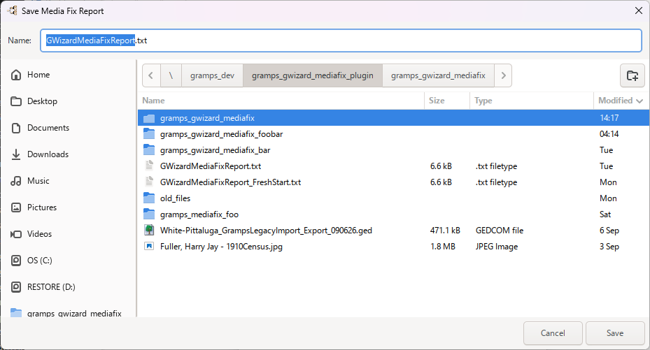
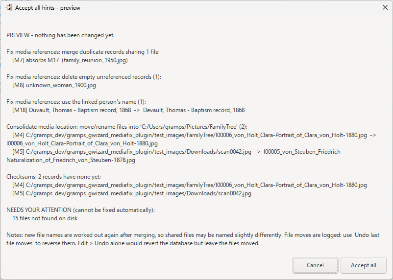

## Overview

GWizard Media Fix is a Gramps tool that inspects all media records in your family tree and helps you repair common media problems. It finds missing media files, consolidates media file locations into relative paths within your media folder, applies standardized filename formats, resolves duplicate media references, corrects misspelled names in media descriptions, and removes leftover import notes. Every change is logged so file moves can be reversed with "Undo last file moves", and every modified media record is tagged with the `GWizard: MediaFixed` tag.

## Usage

Open a family tree in Gramps, then choose **Tools** → **Family Tree Processing** → **GWizard Media Fix** [VERIFY MENU PATH]. The **GWizard Media Fix** window opens.

The main window has one button per fix step, plus an action-area button. Every button except **Close**:

- **Generate report** — Scans every media record and writes a text report listing missing files, non-standard filenames, duplicates, permission errors, and more.
- **Find missing media** — Opens the Find Missing Media dialog to locate missing files and repoint media records at them.
- **Fix media references** — Opens the Fix Media References dialog to merge duplicate records, delete unreferenced records, correct description names, and remove import notes.
- **Consolidate media location** — Opens the Consolidate Media Location dialog to move or copy files into the media folder with standard filenames.
- **Undo last file moves** — Reverses the most recent logged file move or copy operation, moving files back and repointing records.
- **Accept all hints** — Runs every automatic fix across all media fix layers at once, after showing a preview of what will change.

### Generate report

1. Click **Generate report** on the main window. The **Save Media Fix Report** file chooser opens.

   

2. Choose a folder and file name (the default is `GWizardMediaFixReport.txt`). Optionally tick **Check file contents against stored checksums (slower)** to also list files that were edited or replaced since their checksum was stored. Click **Save**.

3. The report is generated and opened in the **Media Fix Report** viewer. If the scan hit its file limit, you are asked whether to scan all files this time or always from now on; choose to keep the current report or re-scan.

   

4. After reading the report, if any files no longer match their stored checksum, you are offered to **Update changed checksums** or **Keep old checksums**. Choosing **Update checksums** stores the new checksums (this can be undone with Edit > Undo).

### Find missing media

1. Click **Find missing media** on the main window. The **Find Missing Media** dialog opens and lists every media record whose file cannot be found on disk.

   

2. Review each row. The **Hint** column suggests where the file may be, found either by content (same checksum) or by file name in the media directory.

3. For any row, type a corrected relative path in the **New Path** field, or click the folder button next to the row to choose the actual file.

4. Click **Look in folder…** to search a folder and its subfolders for many missing files at once (useful after moving a whole folder of media). Choose the folder to search; found files are matched by content or by name and offered as hints.

5. Click **Accept hints (%d)** to set every row's suggested action at once, then review each row.

6. Click **Apply** to repoint each media record at its chosen file. Records whose files are found are tagged `GWizard: MediaFixed`. A message reports how many media paths were updated.
## Configure Options

The following controls appear in the GWizard Media Fix dialogs:

**Consolidate Media Location dialog**

- **Naming Template** — Dropdown with entry; choose or edit the filename standard applied to consolidated files. Presets: Reference ID + Community Standard (`{ref_id}_{surname}_{given}-{doc_type}-{year}`), Community Standard (`{surname}_{given}-{doc_type}-{year}`), Reference ID + Document Type (`{ref_id}_{doc_type}-{year}`), Media ID + Document Type (`{id}_{doc_type}-{year}`), Media ID + Original Name (`{id}_{orig}`), Sanitized Original Name (`{orig}`), Community Standard + content hash (never clashes for different files).
- **Naming style** — Radio buttons: **Use naming standard** (default) or **Keep original filename**.
- **File operation** — Radio buttons: **Move files** (default) or **Make a copy**.
- **Accept hints (%d)** — Sets every row to its suggested standard path or action.
- **Apply** — Moves or copies files and repoints all media records according to the chosen paths.
- **Close** — Closes the dialog.

**Find Missing Media dialog**

- **Base media path** — Entry field showing the folder relative paths are resolved against, with a folder selector button to choose a different folder.
- **Accept hints (%d)** — Sets every row to its suggested file match.
- **Look in folder…** — Searches a chosen folder and its subfolders for missing files, matching by content or by name.
- **Apply** — Repoints each media record at its chosen file.
- **Close** — Closes the dialog.

**Generate report save dialog**

- **Check file contents against stored checksums (slower)** — Checkbox; when enabled, reads every media file that has a checksum and lists files that were edited or replaced since, then offers to store their new checksums after the report is read.

## Features

- Find media files that are missing from disk and repoint media records at the correct files, including matching by content checksum when files have been renamed or moved.
- Consolidate media file locations into relative paths within the base media folder, with optional renaming to a standardized filename format.
- Apply one of seven filename standards, including Reference ID + Community Standard, Community Standard + content hash, and Sanitized Original Name.
- Choose whether to move files or make copies when consolidating.
- Resolve duplicate media references where several records point at the same file, by merging into a keeper record or creating separate file copies.
- Delete unreferenced media records (bare records are suggested for deletion by default).
- Correct media descriptions that misspell the linked person's name (probable spelling variants only).
- Remove leftover "Records not imported into OBJE" import notes from media records whose files are readable again.
- Log every file move and copy so the entire last run can be reversed with **Undo last file moves**.
- Tag every modified media record with `GWizard: MediaFixed`.
- Generate a comprehensive text report summarizing all media issues in the family tree, with an optional slower content-checksum comparison.
- Accept all automatic hints across every fix layer in a single run, with a preview of all planned changes before they are applied.

### Fix media references

1. Click **Fix media references** on the main window. The **Fix Media References** dialog opens and scans for four kinds of issues: media files shared by multiple records, unreferenced image tags, descriptions that misspell the linked person's name, and leftover import notes.

   

2. Review each row. The **Resolution** column offers actions specific to the issue type:

   - **Duplicate file groups**: Merge into keeper, Create separate file copies, or Keep shared (no change).
   - **Unreferenced image tags**: Delete unreferenced record or Keep unreferenced (no change). Bare records with no notes, attributes, tags, citations, or date are suggested for deletion by default.
   - **Name mismatches**: Use the linked person's name or Keep description (no change).
   - **Import notes**: Delete leftover import notes or Keep notes (no change). Records readable again after a GEDCOM import can have their stale "Records not imported into OBJE" notes removed.

   

3. Click **Accept hints (%d)** to set every row to its suggested action, then review each row.

4. Click **Apply** to perform the chosen actions. Duplicate records are merged, separate copies are created, unreferenced records are deleted, descriptions are corrected, and import notes are removed. A message reports the results.

### Consolidate media location

1. Click **Consolidate media location** on the main window. The **Consolidate Media Location** dialog opens and lists media records whose files use absolute or non-standard paths.

   

2. Choose a **Naming Template** from the dropdown (or edit it directly). The presets are:

   - Reference ID + Community Standard (`{ref_id}_{surname}_{given}-{doc_type}-{year}`)
   - Community Standard (`{surname}_{given}-{doc_type}-{year}`)
   - Reference ID + Document Type (`{ref_id}_{doc_type}-{year}`)
   - Media ID + Document Type (`{id}_{doc_type}-{year}`)
   - Media ID + Original Name (`{id}_{orig}`)
   - Sanitized Original Name (`{orig}`)
   - Community Standard + content hash (never clashes for different files)

3. Choose the **Naming style**: **Use naming standard** (default) or **Keep original filename**.

4. Choose the **File operation**: **Move files** (default) or **Make a copy**.

5. Review each row's **New Path** field and edit it if needed. Shared files are listed once and moved once, with every record repointed.

6. Click **Accept hints (%d)** to set every path to its standard suggestion, then review each row.

7. Click **Apply** to move or copy the files and repoint every record. Files with identical content already in the media folder are reused. A message reports how many media file paths were consolidated.

### Undo last file moves

1. Click **Undo last file moves** on the main window. If no file moves have been logged, a message says so and nothing happens.

2. Otherwise the **Undo last file moves** confirmation opens, showing the time of the last run, how many files were moved or copied, and how many media records were repointed.

   

3. Click **Undo moves** to reverse the run: moved files go back to their original locations (copies are left in place), and records are repointed to their previous paths. Records changed since the run are left alone and listed. Click **Cancel** to abort.

4. A **File moves undone** message reports how many files were moved back and how many records were repointed, together with any items needing review.

### Accept all hints

1. Click **Accept all hints** on the main window (the action-area button to the left of **Close**).

2. If no base media path is set, the **No base media path** prompt appears, offering to choose a folder (saved as the family tree's base media path) or continue without consolidation.

3. A preview of every planned change is shown in the **Accept all hints - preview** dialog. Review the list of changes across find missing media, fix references, and consolidate steps.

   

4. Click **Accept all** to run all fixes. Missing files are repointed, references are fixed, files are consolidated, checksums are stored, and a move log is written.

5. When finished, the **Accept All Hints Complete** report opens, summarizing all changes and listing any items that still need human intervention.

   