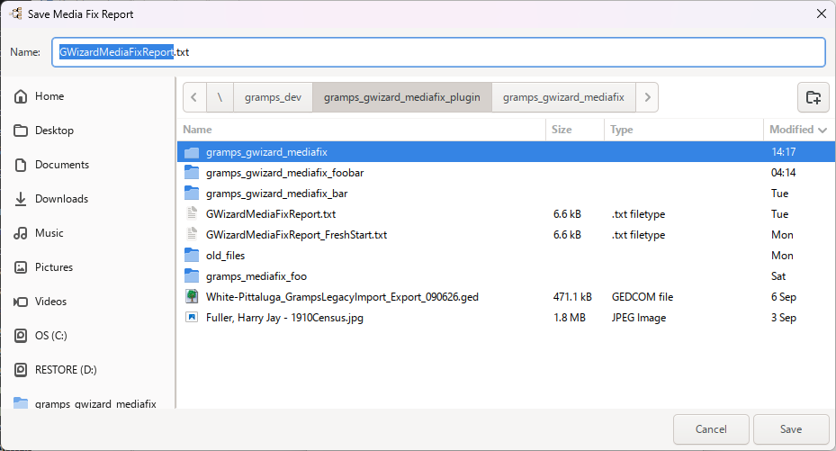
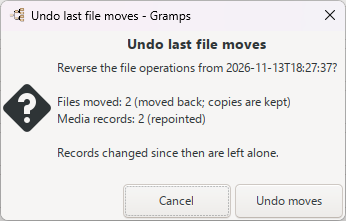
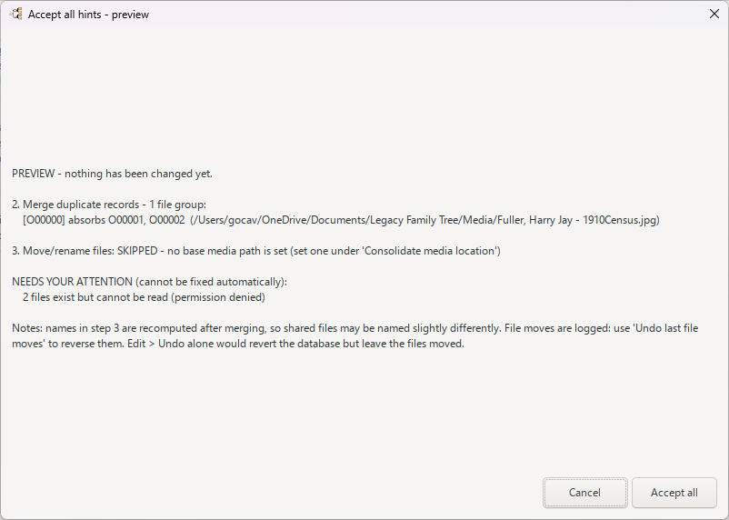
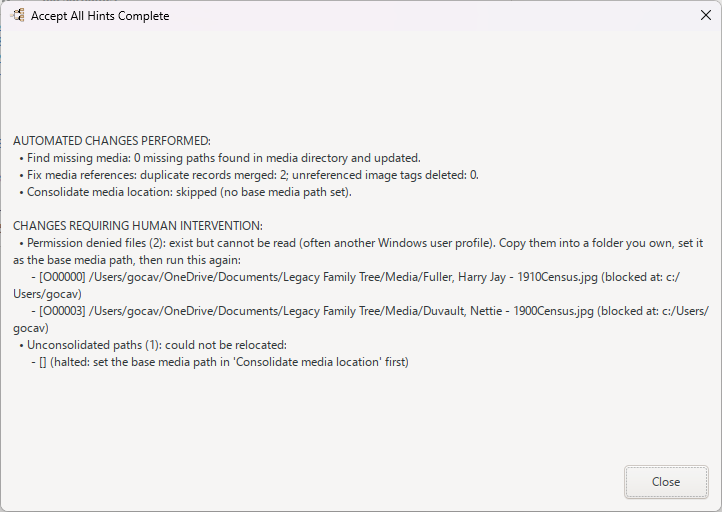

## Overview

The **GWizard Media Fix** tool helps genealogists clean up media files attached to a Gramps Family Tree. It scans the database for missing media files, duplicate media references, and media stored outside the configured media base directory. It can locate missing files, merge duplicate media records, create separate copies of shared files, remove unreferenced media records, consolidate scattered files into a single media folder, and apply a consistent, standardized filename to every media file. A plain-text report summarizes all findings and changes.

## Usage

1. Open Gramps and load the Family Tree you want to work on.
2. Choose **Tools → GWizard Media Fix** [VERIFY MENU PATH].
3. The **GWizard Media Fix** dialog opens. It shows one button for each task, plus **Accept all hints** in the action area and **Close** at the bottom right:
   * **Generate report** — writes a plain-text report listing missing files, permission problems, absolute paths, non-standard filenames, duplicate references, and unreferenced files.
   * **Find missing media** — lists media records whose files are missing on disk and suggests replacement paths found in the media base folder.
   * **Fix media references** — reviews media files shared by multiple records and image tags with no database references; lets you merge, create copies, or delete records.
   * **Consolidate media location** — moves or copies media files into the base media directory using the chosen naming template.
   * **Clean import notes** — removes stale "Records not imported into OBJE" notes left by a Legacy import.
   * **Undo last file moves** — reverses the file operations from the last consolidate run.
   * **Accept all hints** — runs find-missing, fix-references, and consolidate automatically, showing a preview report before applying changes.
4. Click the button for the task you want to run, then follow the steps in that button's section below.
5. When you are finished, click **Close** to return to Gramps.

### Generate report

1. From the main dialog, click **Generate report**.
2. The **Save Media Fix Report** file chooser opens, pre-named `GWizardMediaFixReport.txt` and pointing at the media base folder. Choose the folder and filename, then click **Save**.
   
3. The report is written and the **GWizard Media Fix Report** viewer opens showing the full text.
   
4. Close the viewer to return to the main dialog.

### Find missing media

1. From the main dialog, click **Find missing media**.
2. The **Find Missing Media** dialog opens. It lists each media record whose file is missing on disk, with its current path and a hint (for example, a suggested match found in the media base folder, or "Permission denied").
   
3. Verify or edit the **New Path** for each record. To restore a file from another folder, click **Copy from folder...**, choose the source folder in the **Select folder containing the missing files** chooser, and review the queued copies.
4. To fill in all suggested paths at once, click **Accept hints (N)** (N is the number of hinted items).
5. Click **Apply** to update the database and copy the files into the media directory. A **Media Paths Updated** message confirms the result; if nothing was selected, **Nothing to apply** appears instead.
6. Click **Close** to close the dialog.

### Fix media references

1. From the main dialog, click **Fix media references**.
2. The **Fix Media References** dialog opens. It shows groups where a single media file is shared by multiple media records, plus image tags with no data references in the database.
   
3. For each group, choose a resolution: **Merge** (combine duplicate media records into one keeper), **Create copies** (give each reference its own file), or **Delete** (remove unreferenced media records). Media tagged **GWizard: Locked** is skipped.
4. Click **Accept hints (N)** to apply the suggested resolutions for all groups.
5. Click **Apply** to write the changes. A **Media References Resolved** message summarizes what was merged, copied, or deleted; **Nothing to apply** appears if no actions were selected.
6. Click **Close** when done.

### Consolidate media location

1. From the main dialog, click **Consolidate media location**.

2. The **Consolidate Media Location** dialog opens. Each row shows a media record whose path is not yet consolidated, with a suggested path inside the base media directory.
   
3. Set the options:
   * **Base media path** — type or browse (folder button opens the **Select media directory** chooser) for the folder Gramps uses for relative media paths. The current value is also shown as a read-only **Media Base Path** label.
   * **Naming Template** — choose from the combo presets: Reference ID + Community Standard, Community Standard, Reference ID + Document Type, Media ID + Document Type, Media ID + Original Name, Sanitized Original Name, or Community Standard + content hash.
   * **Naming style** — **Use naming standard** (default) or **Keep original filename**.
   * **File operation** — **Move files** (default) or **Make a copy**.
4. Verify or edit the suggested path for each record, or click **Accept hints (N)** to fill in all suggested paths at once.
5. Click **Apply** to move or copy the files and update the database. A **Media Locations Consolidated** message confirms the result. Files are logged so they can be undone later with **Undo last file moves**.
6. Click **Close** when done.

### Clean import notes

1. From the main dialog, click **Clean import notes**.
2. The **Clean import notes** confirmation dialog opens, listing leftover "Records not imported into OBJE" notes whose media files are now readable.
   
3. Click **Delete** to remove the notes (this can be undone with Edit → Undo), or **Cancel** to keep them.
4. If there are no such notes, a **No stale import notes** message appears instead. Otherwise an **Import notes cleaned** message confirms how many notes were removed.

### Undo last file moves

1. From the main dialog, click **Undo last file moves**.
2. If no logged file moves exist, a **No file moves to undo** message appears instead. Otherwise the **Undo last file moves** confirmation dialog opens, showing the last logged file-move run.
   
3. Click **Undo moves** to move the files back and repoint the media records, or **Cancel** to abort. Records changed since the run, or locked files, are left alone and listed.
4. A **File moves undone** message confirms how many files were moved back and records repointed.

### Accept all hints

1. From the main dialog, click **Accept all hints**.
2. The tool plans the automatic fixes across the find-missing, fix-references, and consolidate steps.
3. The **Accept all hints - preview** dialog opens showing the planned changes. Review the list, then click **Accept all** to proceed, or **Cancel** to abort.
   
4. The fixes run automatically: missing paths are filled, duplicate references are merged or deleted, and media locations are consolidated.
5. The **Accept All Hints Complete** report opens, summarizing the changes performed and listing any items that still require human intervention (for example, missing files not found, permission-denied files, or unconsolidated paths). It also notes optional stale import notes that can be removed with **Clean import notes**.
   
6. Close the report to return to the main dialog.

## Configure Options

The tool has no separate persistent options window; its controls appear in the main window and each sub-dialog:

* **Generate report, Find missing media, Fix media references, Consolidate media location, Clean import notes, Undo last file moves** — task buttons on the **GWizard Media Fix** main window (one per task).
* **Accept all hints** — action-area button on the main window that runs the find-missing, fix-references, and consolidate steps automatically with a preview first.
* **Base media path** — text entry with a folder button opening the **Select media directory** chooser, plus a read-only **Media Base Path** label. Appears in **Find Missing Media** and **Consolidate Media Location**; the changed path is committed to the database when **Apply** is pressed.
* **Naming Template** — combo box with entry offering these presets (in **Consolidate Media Location**):
  * Reference ID + Community Standard — `{ref_id}_{surname}_{given}-{doc_type}-{year}.{ext}`
  * Community Standard — `{surname}_{given}-{doc_type}-{year}.{ext}`
  * Reference ID + Document Type — `{ref_id}_{doc_type}-{year}.{ext}`
  * Media ID + Document Type — `{id}_{doc_type}-{year}.{ext}`
  * Media ID + Original Name — `{id}_{orig}.{ext}`
  * Sanitized Original Name — `{orig}.{ext}`
  * Community Standard + content hash — `{ref_id}_{surname}_{given}-{doc_type}-{year}-{hash}.{ext}`
  Template tokens: `{ref_id}` (reference ID), `{surname}`/`{given}` (linked person's name), `{doc_type}` (media description or type), `{year}` (extracted year), `{orig}` (original filename), `{ext}` (file extension), `{hash}` (short content hash).
* **Naming style** — radio buttons **Use naming standard** (default) or **Keep original filename** (in **Consolidate Media Location**).
* **File operation** — radio buttons **Move files** (default) or **Make a copy** (in **Consolidate Media Location**).
* **Accept hints (N)** — applies the suggested fixes for all listed items at once (N is the count of hinted items). Appears in **Find Missing Media**, **Fix Media References**, and **Consolidate Media Location**.
* **Apply** — writes the reviewed changes to the database and moves/copies the actual files on disk (in **Find Missing Media**, **Fix Media References**, and **Consolidate Media Location**).
* **Copy from folder...** — in **Find Missing Media**, selects a source folder to restore missing files by filename; copies are queued until **Apply** is pressed.
* **Per-record resolution** — in **Fix Media References**, choose **Merge**, **Create copies**, or **Delete** for each duplicate or unreferenced media record using the row selector.
* **Close** — closes the current dialog.

## Features

* **Detect missing media** — finds media records whose files cannot be located on disk and suggests possible matches in the media base folder.
* **Resolve duplicate references** — merges duplicate media records that share the same file, creates separate copies for each reference, or deletes unreferenced media records. Locked media (tagged **GWizard: Locked**) is skipped.
* **Consolidate media locations** — moves or copies media files into the configured base directory, applying a consistent, safe filename from the chosen naming template.
* **Generate a comprehensive report** — produces a plain-text summary of all media issues, including missing files, permission problems, absolute paths, non-standard filenames, duplicate references, unconsolidated paths, and unreferenced files on disk.
* **Automated "Accept all hints"** — runs the find-missing, fix-references, and consolidate steps in sequence, with a preview report listing any items that still require human intervention.
* **Clean stale import notes** — removes "Records not imported into OBJE" notes after the corresponding media files have been restored.
* **Fixed-media tagging** — media that has been fixed is tagged **GWizard: MediaFixed** so it is not reprocessed unnecessarily.
* **Undo file moves** — reverses the file operations from the last consolidate run using the saved file-move log.
