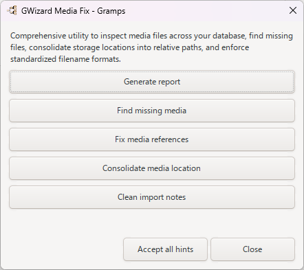
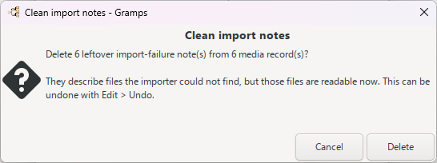
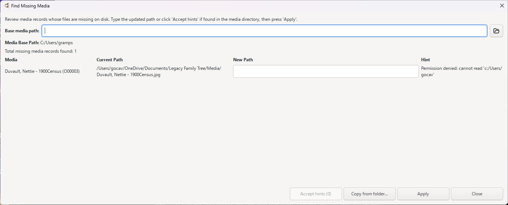
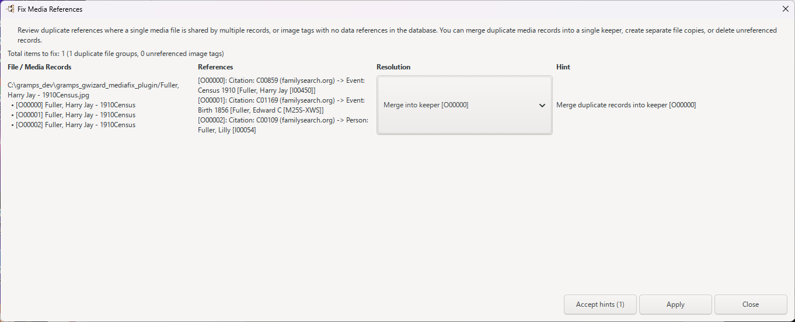
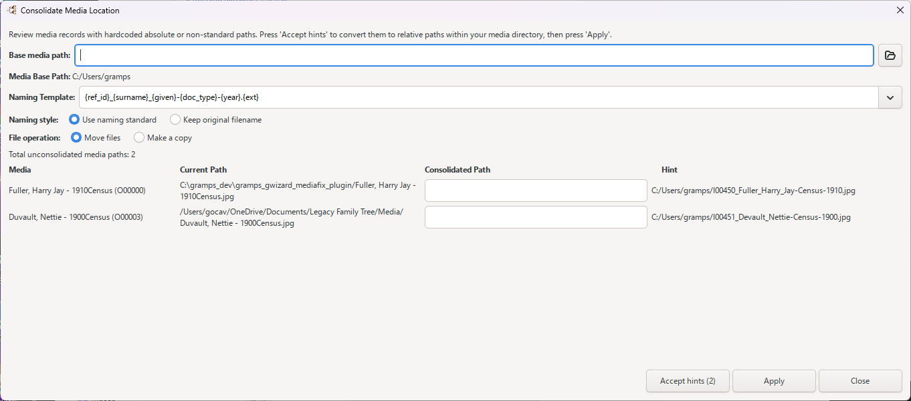
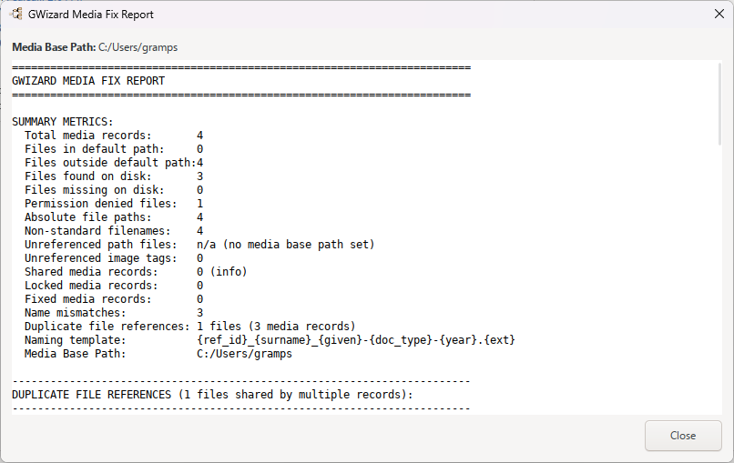

## Overview

The **GWizard Media Fix** tool helps genealogists clean up media files attached to a Gramps Family Tree. It scans the database for missing media files, duplicate media references, and media stored outside the configured media base directory. It can locate missing files, merge duplicate media records, create separate copies of shared files, remove unreferenced media records, consolidate scattered files into a single media folder, and apply a consistent, standardized filename to every media file. A plain-text report summarizes all findings and changes.

## Usage

1. Open Gramps and load the Family Tree you want to work on.
2. Choose **Tools &rarr; Family Tree Processing &rarr; GWizard Media Fix**.
   
3. The **GWizard Media Fix** dialog opens. Choose one of the following actions:
   * **Generate report** – writes a plain-text report (`GWizardMediaFixReport.txt`) listing missing files, permission problems, absolute paths, non-standard filenames, duplicate references, and unreferenced files.
   * **Find missing media** – lists media records whose files are not present on disk, suggests matches found in the media base folder, and lets you type or browse to a new path for each.
   * **Fix media references** – reviews media files shared by multiple records (duplicates) and image tags with no database references, then lets you merge, create copies, or delete records.
   * **Consolidate media location** – moves or copies media files into the base media directory and renames them using the selected naming template.
   * **Clean import notes** – removes stale "Records not imported into OBJE" notes left by a Legacy import after the matching media files have been restored.
   * **Accept all hints** – runs the find-missing, fix-references, and consolidate steps automatically, showing a preview report before applying changes.
   
4. For most actions, review the preview table, edit any suggested paths as needed, then click **Apply** (or **Accept hints**) to write changes to the database and move or copy the actual files on disk.
5. When finished, click **_Close** to return to Gramps.

### Find missing media

1. From the main dialog, click **Find missing media**.
2. The **Find Missing Media** dialog lists each missing media record with its current path and a hint (for example, "Found in media directory: suggest ..." or "Permission denied: ...").
3. Verify or edit the **New Path** for each record, or click **Accept hints (N)** to fill in the suggested paths automatically.
4. To restore a file from another folder, click **Copy from folder...**, select the source folder, then click **Apply** to copy the file into the media directory and update the record.
5. Click **Apply**, then **_Close**.
   

### Fix media references

1. From the main dialog, click **Fix media references**.
2. The **Fix Media References** dialog shows groups where a single media file is shared by multiple media records, plus image tags with no data references in the database.
3. For each group, choose a resolution: **Merge** (combine duplicate media records into one keeper), **Create copies** (give each reference its own file), or **Delete** (remove unreferenced media records).
4. Click **Accept hints (N)** to apply the suggested resolutions, then **Apply** to write the changes.
5. Click **_Close** when done.
   

### Consolidate media location

1. From the main dialog, click **Consolidate media location**.
   *Note: If duplicate media references exist, you are prompted to resolve them with **Fix media references** first.*
2. In the **Consolidate Media Location** dialog, confirm the **Base media path** (browse with the folder button if needed).
3. Choose a **Naming Template** from the list, or type a custom pattern in the entry field.
4. Choose the **Naming style**: **Use naming standard** (applies the template) or **Keep original filename**.
5. Choose the **File operation**: **Move files** (renames the original file) or **Make a copy** (leaves the original untouched).
6. Click **Accept hints (N)** to populate suggested new paths, review the table, then click **Apply** to move or copy the files and update the database records.
7. Click **_Close** when done.
   

### Generate a report

1. From the main dialog, click **Generate report**.
2. A file chooser opens; the default name is `GWizardMediaFixReport.txt`. Choose a location and save the report.
3. Review the report for items requiring human intervention, such as missing files, permission problems, or unconsolidated paths.
   

## Configure Options

The tool has no separate persistent options window; its controls appear within each sub-dialog:

* **Base media path** – a text entry (with a folder browse button) showing the folder Gramps uses for relative media paths. Appears in the **Find Missing Media** and **Consolidate Media Location** dialogs; the current media base path is also shown as a read-only **Media Base Path** label.
* **Naming Template** – a combo box with an entry field offering these presets (in the **Consolidate Media Location** dialog):
  * `{ref_id}_{surname}_{given}-{doc_type}-{year}.{ext}` — Reference ID + Community Standard
  * `{surname}_{given}-{doc_type}-{year}.{ext}` — Community Standard
  * `{ref_id}_{doc_type}-{year}.{ext}` — Reference ID + Document Type
  * `{id}_{doc_type}-{year}.{ext}` — Media ID + Document Type
  * `{id}_{orig}.{ext}` — Media ID + Original Name
  * `{orig}.{ext}` — Sanitized Original Name
  * `{ref_id}_{surname}_{given}-{doc_type}-{year}-{hash}.{ext}` — Community Standard + content hash (never clashes for different files)
  * Template tokens: `{ref_id}` (reference ID), `{surname}`/`{given}` (linked person's name), `{doc_type}` (media description/type), `{year}` (extracted year), `{orig}` (original filename), `{ext}` (file extension), `{hash}` (short content hash).
* **Naming style** – radio buttons **Use naming standard** (default) or **Keep original filename**.
* **File operation** – radio buttons **Move files** (default) or **Make a copy**.
* **Accept hints (N)** – applies the suggested fixes for all listed items (N is the count of hinted items).
* **Apply** – writes the reviewed changes to the database and moves/copies files on disk.
* **Copy from folder...** – in **Find Missing Media**, selects a source folder to restore a missing file from.
* Per-record resolution in **Fix Media References** – **Merge**, **Create copies**, or **Delete** for each duplicate or unreferenced media record.
* **_Close** – closes the current dialog.

## Features

* **Detect missing media** – finds media records whose files cannot be located on disk and suggests possible matches in the media base folder.
* **Resolve duplicate references** – merges duplicate media records that share the same file, creates separate copies for each reference, or deletes unreferenced media records. Locked media (tagged **GWizard: Locked**) is skipped.
* **Consolidate media locations** – moves or copies all media files into the configured base directory, applying a consistent, safe filename from the chosen naming template.
* **Generate a comprehensive report** – produces a human-readable summary of all media issues, including missing files, permission problems, absolute paths, non-standard filenames, duplicate references, unconsolidated paths, and unreferenced files on disk.
* **Automated "Accept all hints"** – runs the find-missing, fix-references, and consolidate steps in sequence, with a preview report listing any items that still require human intervention.
* **Clean stale import notes** – removes "Records not imported into OBJE" notes after the corresponding media files have been restored.
* **Fixed-media tagging** – media that has been fixed is tagged **GWizard: MediaFixed** so it is not reprocessed unnecessarily.

