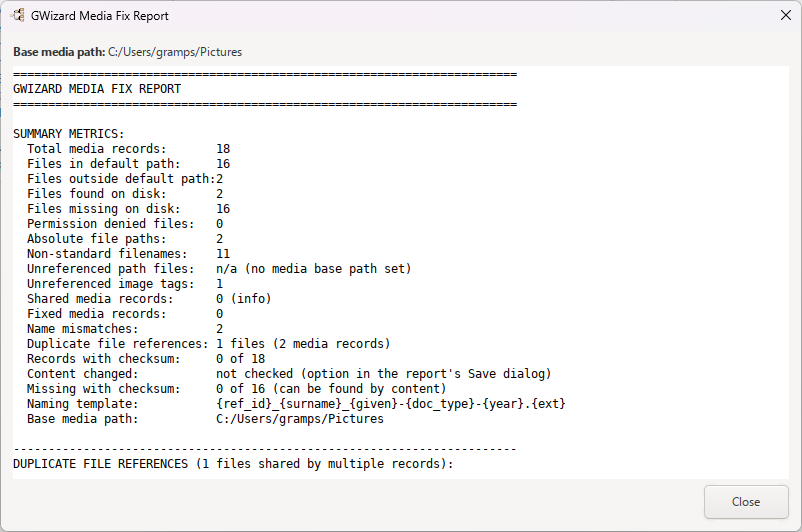
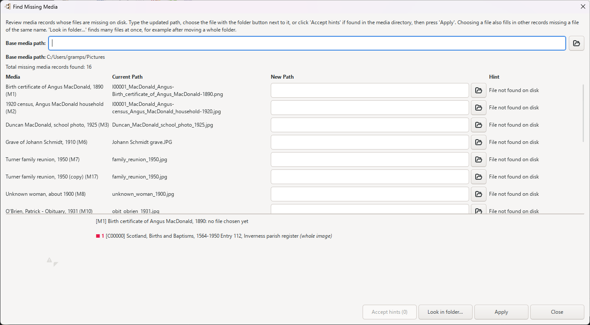
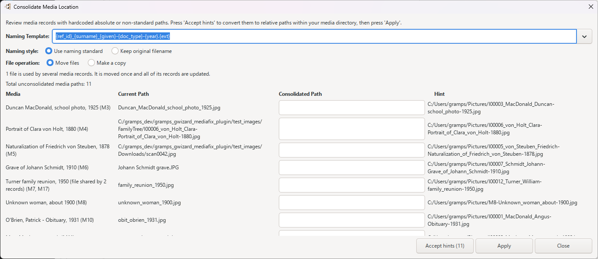
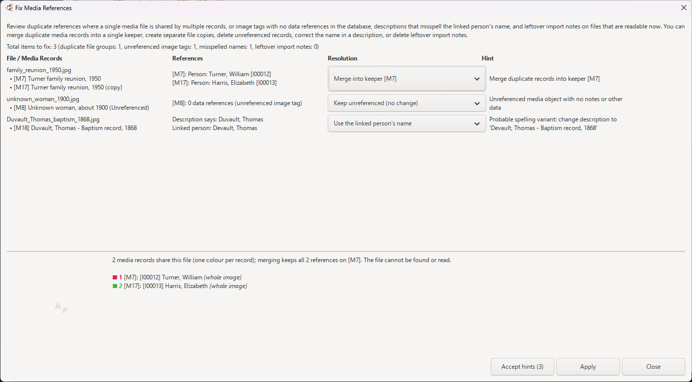
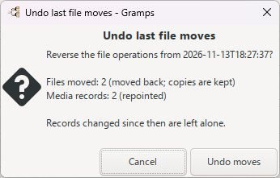
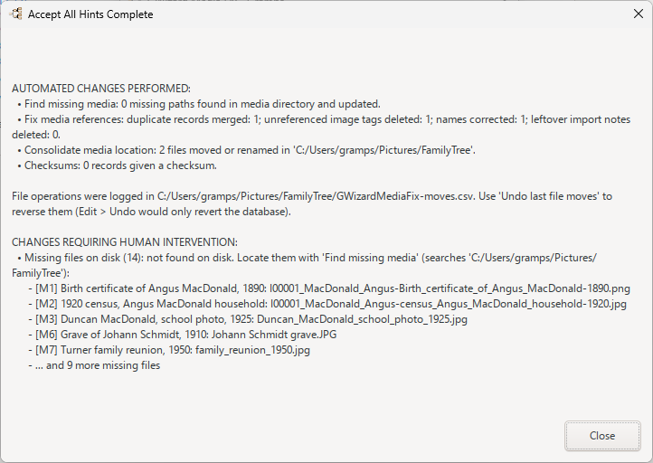

#
# Gramps - a GTK+/GNOME based genealogy program
#
# Copyright (C) 2026  Kevin White
#
# This program is free software; you can redistribute it and/or modify
# it under the terms of the GNU General Public License as published by
# the Free Software Foundation; either version 2 of the License, or
# (at your option) any later version.
#
# This program is distributed in the hope that it will be useful,
# but WITHOUT ANY WARRANTY; without even the implied warranty of
# MERCHANTABILITY or FITNESS FOR A PARTICULAR PURPOSE.  See the
# GNU General Public License for more details.
#
# You should have received a copy of the GNU General Public License
# along with this program; if not, write to the Free Software
# Foundation, Inc., 51 Franklin Street, Fifth Floor, Boston, MA 02110-1301 USA.
#
## Overview

The **GWizard Media Fix** tool helps you find missing media files, consolidate media locations into standardized relative paths, and enforce consistent filename formats across your entire Gramps database. It provides a step-by-step interface with dedicated buttons for each media-fix operation, allowing you to preview changes, apply fixes, and generate a comprehensive report of all actions taken.

This tool is particularly useful when:
- Media files have been moved or renamed outside of Gramps and are now marked as missing
- You want to standardize media filenames according to a community format
- You need to resolve duplicate or shared media references
- You want to clean up stale import notes from legacy GEDCOM imports

## Usage

The tool is available from the **Tools** menu in Gramps: **Tools → GWizard Media Fix**. Clicking the menu entry opens the main GWizard Media Fix window. Follow the steps below in order, using the buttons in the interface.

1. **Generate report** — Opens a file chooser dialog to select where to save the media fix report. After saving, the report opens in a viewer dialog showing a summary of all media fix operations.
2. **Find missing media** — Opens the **Find Missing Media** dialog, which scans the database for media records whose files cannot be located on disk. You can accept hints, select files manually, or copy files from a folder.
3. **Fix media references** — Opens the **Fix Media References** dialog, which identifies and helps resolve duplicate or shared media references in the database. You can merge duplicate records, create copies, or delete unreferenced media.
4. **Consolidate media location** — Opens the **Consolidate Media Location** dialog, which moves or copies media files to a standardized base location and applies naming conventions. Buttons include: Use naming standard, Keep original filename, Move files, and Make a copy.
5. **Clean import notes** — Removes stale import notes from the database that were left over from legacy GEDCOM imports. Presents a confirmation dialog with **Delete** and **Cancel** options.
6. **Undo last file moves** — Reverses the most recent file-move log, moving files back to their original locations and repointing database records. Shows a confirmation step before undoing.
## Configure Options

The following GUI controls and options are available in the GWizard Media Fix tool:

- **Generate report** button — Opens file chooser to save the media fix report as `GWizardMediaFixReport.txt`
- **Find missing media** button — Scans for media records with unresolvable file paths
- **Fix media references** button — Merges duplicate media records and handles unreferenced files
- **Consolidate media location** button — Moves/copies media to a base path with naming options
  - *Use naming standard* — Apply community-standard filename format
  - *Keep original filename* — Retain the original filename during consolidation
  - *Move files* — Move files to the new location
  - *Make a copy* — Copy files to the new location instead of moving
- **Clean import notes** button — Removes stale import notes from the database
- **Undo last file moves** button — Reverses the most recent file-move log entry
- **Accept all hints** button — Executes the full automated fix pipeline (find missing → fix references → consolidate)
- **Close** button — Closes the main tool window

Additional options within sub-dialogs:
- **Find Missing Media**: Accept hints, Copy from folder..., Apply, Select media directory, Select file for specific missing media
- **Fix Media References**: Merge, Create copies, Delete options for duplicate/shared media
- **Consolidate Media Location**: Accept hints, Apply changes after configuring move/copy options
- **Accept All Hints Complete**: Summary of all automated changes performed, including any requiring human review

## Features

- **Find missing media**: Scans the entire database for media records whose files are not found on disk, with options to accept hints or manually locate files.
- **Fix media references**: Identifies and resolves duplicate or shared media references by merging records, creating copies, or deleting unreferenced entries.
- **Consolidate media location**: Moves or copies media files to a standardized base folder and applies configurable filename naming standards.
- **Clean import notes**: Removes stale import notes from the database that were left over from legacy GEDCOM imports, keeping the database clean.
- **Undo last file moves**: Reverses the most recent file-move log, restoring files to their original locations and repointing database records.
- **Generate report**: Creates a comprehensive text report of all media fix operations performed, savable to a user-specified location.
- **Accept all hints (automated)**: Executes the full fix pipeline (find missing → fix references → consolidate) in one click, with a complete summary report showing what was changed and what requires human review.

### <Generate report>
- Clicking this button opens the **Save Media Fix Report** file chooser dialog (Save mode). After selecting a path and saving, the generated report opens in the **Media Fix Report** viewer dialog.
- Screenshot: 
- After saving, the **Media Fix Report** viewer dialog displays the report text.
- Screenshot: 

### <Find missing media>
- Opens the **Find Missing Media** dialog. Buttons include: Accept hints (%d), Copy from folder..., Apply, and Close.
- Screenshot: 

### <Fix media references>
- Opens the **Fix Media References** dialog. Buttons include: Accept hints (%d), Apply, and Close.
- Screenshot: 

### <Consolidate media location>
- Opens the **Consolidate Media Location** dialog. Buttons include: Use naming standard, Keep original filename, Move files, Make a copy, Accept hints (%d), Apply, and Close.
- Screenshot: 

### <Clean import notes>
- Opens a confirmation dialog asking if you want to delete stale import notes. Buttons: **Delete** and **Cancel**.
- Screenshot: 

### <Undo last file moves>
- Opens a confirmation step for undoing the last file moves. Buttons: **Undo moves** and **Cancel**.
- Screenshot: 

### <Accept all hints>
- Runs the automated fix pipeline: finds missing media, fixes references, and consolidates locations. After the run, shows the **Accept All Hints Complete** dialog with a full summary.
- Screenshot: 
- After completion: 